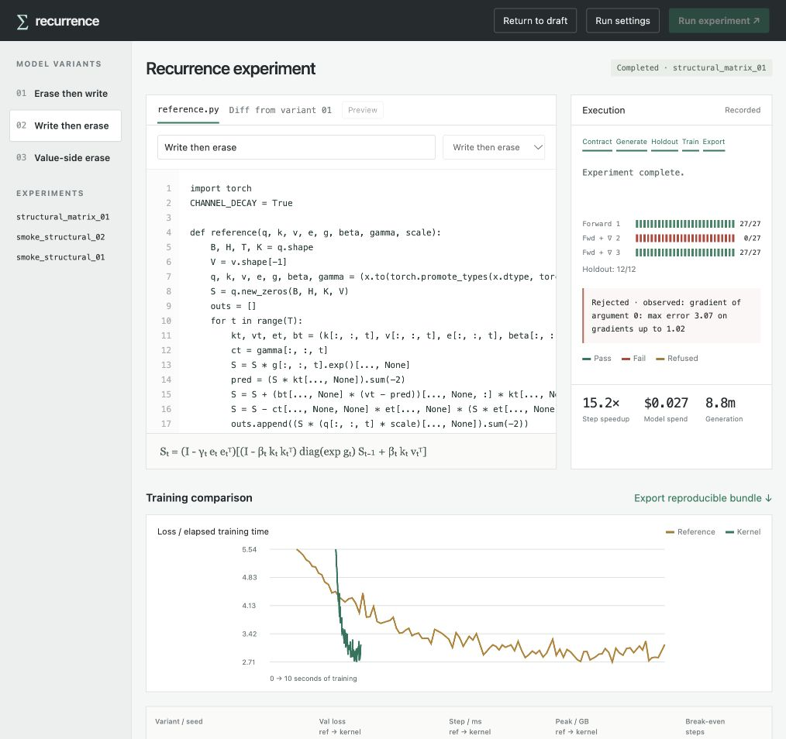
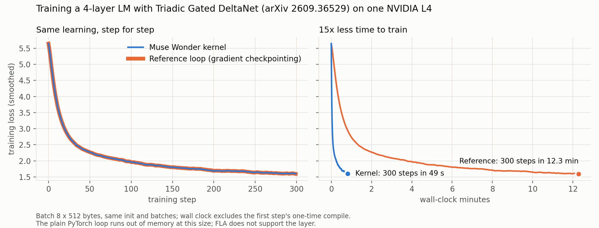

# Recurrence — change the model, keep training

**Built during the Meta Global AI Developer Hackathon (Oct 26 to Nov 4, 2026).** Everything under
`kernel_contract/` and every commit after upstream `e064717` was written during the event; the rest of
this repository is upstream [KernelAgent](https://github.com/meta-pytorch/KernelAgent), described below.

The workbench takes a researcher-edited PyTorch recurrence through contract capture, Meta-model kernel generation,
forward/backward checking, fresh post-selection evaluation, paired training, and reproducible export. Compare up to
three **structural model variants** under one shared model budget. Changing erase direction, update order or readout
changes the computation; a scalar sweep is not presented as a new architecture.

The main researcher interface is a code editor:

```python
@muse_kernel.fast
def reference(q, k, v, e, g, beta, gamma, scale):
    # Your PyTorch recurrence, including the structural model edit.
    ...
```

[Open the runnable training example](examples/muse_kernel/research.py) and
[the editor demo guide](docs/EDITOR_DEMO.md), with [executed validation receipts](docs/EDITOR_RESULTS.md). The decorator captures real calls and guards kernel reuse;
the workbench displays evidence and compares experiments. Use `muse_kernel.train_step` when you need
recovery from an ordinary backward failure before the optimizer updates parameters.

```bash
pip install -e ".[research]"  # CUDA Linux; the dashboard itself can run on macOS
recurrence-workbench --remote "ssh gpu-host" --remote-dir /workspace/recurrence
```



The GPU host needs the same installed source. Model API keys stay on the machine running the workbench.
See [the workbench guide](docs/WORKBENCH.md), [validation protocol](docs/VALIDATION.md), and
[event contribution manifest](docs/HACKATHON_CONTRIBUTIONS.md). New controlled results are in [the three-variant report](docs/WORKBENCH_RESULTS.md). The measurements below are historical;
they predate the workbench's fresh holdout and multi-batch training protocol unless explicitly marked otherwise.

New sequence layers (delta rules, erase/write variants, gated recurrences) ship as a slow Python loop over
time. At larger shapes the loop can be slow or exceed memory; implementing an efficient backward pass adds further work. This project hands a Meta model the equation and
the slow loop and gets back a chunked Triton forward **and backward** that a training run can use, checked
by an independent contract the model does not control.



- **Writer:** Muse Wonder or Muse Spark 1.3 Contributor (Meta Model API), or Muse Spark Open (open weights,
  via Baseten).
- **Prompt:** only the equation, the reference loop, the target GPU, "match the reference on any inputs it
  accepts" and "use your own Triton". No algorithm hints, no expert timings.
- **Feedback:** only the checker's counterexamples and the GPU profile. No human edits.
- **Checker:** float64 ground truth; fresh seeds, value scales and shifts, size changes (odd head dims,
  ragged T), strided, transposed and offset layouts, sampled decay and gate values across several ranges
  (edges, typical, high, mid), a compound case, the exact timed and training shapes drawn at the timing
  distribution, K != V, and every gradient against float64 autograd. 41 cases per kernel.

## Results (NVIDIA L4, B=4, H=8, T=2048, K=V=128, same-pod back-to-back medians)

| Layer | Writer | Forward | Fwd+bwd | Slow loop fwd / fwd+bwd | Best existing route fwd / fwd+bwd | Model cost |
|---|---|---|---|---|---|---|
| Gated delta rule (calibration) | Muse Wonder | 1.65 ms | 16.2 ms | 361 / 3551 ms | FLA 1.53 / 5.7 ms | $2.68 |
| Scalar-decay EDA (arXiv 2606.26560) | Muse Wonder | 2.16 ms | 32.2 ms | 220 / 4540 ms | FLA interleave 4.21 / 12.1 ms | $3.94 |
| Variant written before any model saw it (`6c22865`) | Muse Wonder | 5.87 ms | 23.6 ms | 500 / 6064 ms | KDA interleave 8.27 / 22.4 ms | $3.19 |
| Same variant | Muse Spark Open | 11.0 ms | 397 ms | 500 / 6064 ms | KDA interleave 8.27 / 22.4 ms | $0.96 |
| Value-side erase, two-sided (`e66fffc`) | Muse Wonder | recurrent path | 124 ms | 220 / 5371 ms | none (no key-side reduction) | $6.64 |

Model cost is priced from each run's own token usage, including truncated and repair calls.

Warm `torch.compile` of the slow loop: gated delta rule forward 37.4 ms after 24 minutes of compiling;
EDA forward 83 ms after 43 minutes.

**Training** (byte-level LM with the variant as its mixer, 4 layers, 300 steps, same init and batches):

| Mixer | Step time | Final val loss | Peak memory |
|---|---|---|---|
| Slow reference loop | 2585 ms | 1.662 | 14.1 GB |
| Same loop under `torch.compile` (warm; first step took 38 min to compile) | 383 ms | (30 steps run) | |
| Muse Wonder kernel | 52.6 ms | 1.661 | 1.3 GB |
| KDA interleave (expert route) | 46.6 ms | 1.664 | 1.3 GB |

Wonder's kernel is 49x faster per step than the eager loop and 7.3x faster than the warm compiled loop.
The kernel's loss tracks the reference within 0.005 over the first 10 steps (0.038 max over 300, the same
as the expert route), and every parameter gradient matches the reference to within 0.9% on step one.

The value-side erase, S_t = (I - beta k k^T) D S_{t-1} (I - gamma u u^T) + beta k v^T, has no applicable expert reduction in this benchmark implementation. Wonder's chunked forward and backward passed the original suite at 8.2 / 29.6 ms, but they
branched on the gate range and the suite never drew gates where training lives. A training run hit the
untested branch; widening the suite exposed wrong gradients there; Wonder then diagnosed that its chunk
transform inverts the erase product, which is unstable for gamma > 0.5, and routed those inputs to its
recurrent kernels. The repaired result passed the applicable empirical suite but is not chunk-fast at typical gates; the
unverified fast-path run is kept in `runs_public/wonder_vse1_unverified_fastpath`.

**What the checker caught along the way** (all fixed by the model from the counterexample alone): shared
memory overflow on the first write of every layer; silently wrong values at head dims 65 and 129; an
optimized kernel that was wrong only when the state decays almost fully each step; a backward with a wrong
`dq` on every input.

## Generating Triadic Gated DeltaNet kernels for an L4

The [Triadic Linear Attention paper](https://arxiv.org/abs/2609.36529) and its
[official implementation](https://github.com/OliverSieberling/TriadicLinearAttention) already provide custom
forward/backward kernels targeting H100/sm90. This project does not invent Triadic GDN or establish that no
implementation exists. It demonstrates model-generated Triton kernels for the local reference on an L4;
equivalence to every feature of the authors' implementation has not been established.

Triadic Gated DeltaNet (arXiv 2609.36529, September 2026) applies the delta rule to the joint key
k_t ⊗ k'_t, so the state is 512 x 128 per head (`kernel_contract/layers/triadic_gdn.py`). FLA's per-channel
route refuses it ("only support key headdim <=256 for KDA, got 512"), and the slow loop runs out of the L4's
22 GB when training at the benchmark shape.

| Writer | Forward | Fwd+bwd | Model cost |
|---|---|---|---|
| Slow reference loop | 506 ms | out of memory (1234 ms at B=1, H=4, T=1024) | |
| Muse Wonder | 5.96 ms | 131 ms | $2.85 |
| Muse Spark 1.3 Contributor | 8.9 ms | 218 ms | $0.03 |
| Muse Spark Open | 60 ms | 2640 ms | $0.99 |

All three pass the full suite, gradients included. The released kernels are
`kernel_contract/recur_cands/triadic_gdn_*.py`; transcripts are in `runs_public/triadic/`.

**Training with it** (the byte-level LM above with Triadic GDN as its mixer, 4 layers, batch 8 x 512):

| Mixer | Step time | Peak memory | Val loss after 300 steps |
|---|---|---|---|
| Slow reference loop | out of memory on the 22 GB L4 | | |
| Same loop with gradient checkpointing | 2460 ms | 9.5 GB | 1.739 |
| Muse Wonder kernel | 164 ms | 1.2 GB | 1.744 |

The kernel trains 15x faster than the checkpointed loop with an eighth of the memory, and both reach
close validation losses in this single-seed, single-validation-batch experiment. At a size where the
plain loop fits (batch 2 x 256), the two match from the same init and batches: every parameter gradient
agrees within 1.3% on step one (median 0.6%), validation loss is 2.536 vs 2.535 at step 25 and 2.136 vs 2.158
at step 150, and the kernel step takes 28.8 ms against 690 ms. Logs are in `runs_public/train_triadic/`.

### Turnaround, not just step speed

The recorded Triadic Wonder run spans 28.7 minutes from its first to last event. At the measured median
training-step times, 300 steps save about 11.5 minutes; charging the whole generation run upfront gives
an approximate break-even of 750 steps, before other overhead. Model-token cost excludes GPU rental.
The workbench reports generation/checking time, cached training, time to a configured validation target,
and GPU cost estimates separately. No end-to-end speedup is inferred solely from kernel timing.

## Benchmark: 12 recurrent layers, three Meta models

Twelve layers (`kernel_contract/layers/b01_gdr.py` ... `b12_two_sided.py`), each checked against its matrix
form. A successful run means the observed workload passed without blocking errors; some size probes were
explicitly unsupported and some reference-invalid cases were skipped. It does not mean every case passed. Five have no applicable expert route in this benchmark implementation; this is not an exhaustive absence claim. Each cell shows verified forward ms / verified fwd+bwd ms (speedup over
the eager loop) and the run's model cost; ✗ means no candidate met the acceptance policy within the run's budget
($6 Wonder, $1 Contributor, $4 Spark Open). The expert route is the fastest FLA kernel computing the same
equation.

| Layer | Expert route fwd+bwd | Wonder | Spark 1.3 Contributor | Spark Open |
|---|---|---|---|---|
| b01 gated delta rule | 5.5 ms | 2.2 / 16 ms (208×), $4.40 | 3.1 / 46 ms (71×), $0.04 | 5.5 / ✗, $0.85 |
| b02 KDA | 10.6 ms | 2.4 / 22 ms (186×), $4.33 | 2.4 / 41 ms (102×), $0.03 | 3.2 / 1386 ms (3×), $0.35 |
| b03 EDA | 12.4 ms | 4.2 / 63 ms (70×), $2.42 | 6.9 / 55 ms (81×), $0.03 | 4.0 / 55 ms (80×), $0.48 |
| b04 EDA, per-channel | 22.6 ms | 18.5 / 79 ms (68×), $2.00 | 7.9 / 77 ms (69×), $0.03 | 4.8 / 59 ms (89×), $0.47 |
| b05 write-erase | 22.6 ms | 12.6 / 49 ms (109×), $1.86 | 4.9 / 62 ms (86×), $0.02 | 10.8 / 348 ms (15×), $0.67 |
| b06 value erase | none | 24.4 / 106 ms (50×), $2.16 | 13.5 / 90 ms (60×), $0.04 | 12.7 / ✗, $0.95 |
| b07 coupled erase | 22.6 ms | 200.1 / 46 ms (117×), $4.22 | 8.5 / 64 ms (84×), $0.02 | 11.1 / 86 ms (62×), $0.74 |
| b08 read before write | none | 12.9 / ✗, $2.46 | 4.7 / ✗, $0.04 | 3.4 / ✗, $0.56 |
| b09 decay after write | none | 4.8 / ✗, $3.01 | 3.3 / ✗, $0.04 | 6.7 / ✗, $0.80 |
| b10 negative eigenvalues | 5.8 ms | 2.6 / ✗, $2.42 | 3.3 / ✗, $0.04 | 4.5 / 69 ms (46×), $0.85 |
| b11 additive write | none | 3.5 / 54 ms (97×), $2.99 | 4.0 / 57 ms (93×), $0.03 | 9.1 / 90 ms (58×), $0.70 |
| b12 two-sided | none | 24.5 / 213 ms (26×), $3.87 | 15.5 / 98 ms (56×), $0.05 | ✗ / ✗, $0.31 |

| Writer | Verified forward | Verified fwd+bwd | Model cost |
|---|---|---|---|
| Muse Wonder | 12/12 | 9/12 | $36.13 ($3.01 per layer) |
| Muse Spark 1.3 Contributor | 12/12 | 9/12 | $0.39 ($0.03 per layer) |
| Muse Spark Open | 11/12 | 7/12 | $7.73 ($0.64 per layer) |

**Escalation.** b08 and b09 were run once more with escalation (`--handoff`): Wonder continues Contributor's
run from its verified forward, and its first backward passes all 41 recorded cases on both layers.

| Layer | Contributor, then Wonder | Model cost |
|---|---|---|
| b08 read before write | 4.9 / 49 ms (85×) | $0.04 + $1.63 |
| b09 decay after write | 3.3 / 50 ms (85×) | $0.04 + $0.71 |

Across the models and these additional runs, all 12 layers have an accepted forward/backward implementation
for the observed workload. This is portfolio coverage, not a 12/12 success rate for one fixed strategy. The expert kernels are still
2 to 3 times faster on the two most-tuned layers (b01, b02). The `@muse_kernel.fast` decorator escalates the
same way by default: Contributor first, Wonder only if Contributor fails. Transcripts are in
`runs_public/handoff/`.

Regenerate the table with `python -m kernel_contract.bench_report runs_public/bench1 runs_public/bench1/bench_baselines.json`.

## One decorator: `@muse_kernel.fast`

```python
import muse_kernel

@muse_kernel.fast
def my_layer(q, k, v, g, beta, scale):
    ...  # the reference loop, unchanged
```

Train as usual. After two calls the decorator has seen the real shapes, dtypes and value ranges, writes them
into a contract, and starts a background build (Spark 1.3 Contributor plus the checker above, escalating to Wonder if it fails). Once a forward+backward
kernel passes, calls with a verified shape, dtype and value range go to the kernel; anything else still runs
your function. Caches bind captured source and dependencies, device/layout signatures, software and hardware identity,
and the selected kernel hash. A changed environment requires revalidation; recreate the decorator after source edits. On `examples/muse_kernel/smoke.py` (a gated delta rule) the training
step went from 456 ms to 8.7 ms once the kernel landed (29/29 cases, $0.03 with Spark 1.3 Contributor).

Forward invocation failures fall back to the reference. For backward failures, use `muse_kernel.train_step`
to retry the whole loss/backward computation before the optimizer updates parameters. The loss closure must
not mutate parameters or step the optimizer; fatal CUDA context failures still require restarting the worker.

With Muse Code, the project skill in `.agents/skills/fast-recurrence/` lets you ask in plain English ("this
recurrence is too slow to train, make it fast and trainable"); Muse Code adds the decorator and leaves the
reference loop alone.

**Known limits.** Kernels that fail at K=V=129 do so by running out of shared memory. Speeds are for one
GPU and one shape. The EDA here uses scalar decay; the paper's main form is per-channel. Muse Wonder
reports a February 2026 training cutoff, before EDA was posted; self-reports are not proof.

## Reproduce

```bash
pip install -e . && pip install flash-linear-attention==0.6.0
echo "MODEL_API_KEY=..." > .env          # Meta Model API; BASETEN_API_KEY for Spark Open
python -m kernel_contract.paper_agent --model muse-wonder-1.0 --layer wek --eager-ms 500 \
    --remote "ssh gpu-host" --out runs/mine     # model calls run locally, kernels are checked on the GPU host
python -m kernel_contract.recur_eval kernel_contract/recur_cands/wek_wonder_fwdbwd.py --layer wek --grads
python -m kernel_contract.rematch --layer wek --fwd kernel_contract/recur_cands/wek_wonder_fwd.py \
    --fwdbwd kernel_contract/recur_cands/wek_wonder_fwdbwd.py
python -m kernel_contract.train_demo --layer wek --mixer kernel_contract/recur_cands/wek_wonder_fwdbwd.py --out k.jsonl
```

Full transcripts of every run (prompts, responses, checker verdicts, costs) are in `runs_public/`. Spend is
capped per run and overall; calls use atomic conservative reservations, including pending calls (`utils/providers/meta_provider.py`).

---

# Upstream: KernelAgent


KernelAgent turns PyTorch programs into verified Triton kernels and optimize its performance. It was designed around KernelBench workloads and combines:

- Static problem analysis to decide whether to run a lightweight path or a full pipeline
- LLM‑assisted refactoring that isolates fusable subgraphs
- Parallel Triton kernel generation with strict runtime verification
- End‑to‑end composition that rebuilds the original forward pass using only the synthesized kernels
- Hardware‑guided optimization pipeline that iteratively improves performance

GPU Kernel Synthesis Blog post: [PyTorch KernelFalcon](https://pytorch.org/blog/kernelfalcon-autonomous-gpu-kernel-generation-via-deep-agents/)

GPU Kernel Optimization Blog post: [PyTorch KernelAgent](https://pytorch.org/blog/kernelagent-hardware-guided-gpu-kernel-optimization-via-multi-agent-orchestration/)

## Kernel Generation Pipeline Overview


Every stage writes artifacts to a run directory under `.fuse/<run_id>/`, including the fused PyTorch code, `subgraphs.json`, individual KernelAgent sessions, and the final `compose_out/composed_kernel.py`.

## KernelAgent Multi-Worker Optimization Pipeline Overview

Every stage writes artifacts to a run directory under `.optimize/<run_id>/`, including the input Triton kernel, artifacts, individual optimization worker sessions, and the final `output/best_kernel.py`.


## Quickstart

### Requirements
- Python 3.8 – 3.12
- Linux or macOS
- **GPU Requirements (one of the following):**
  - **CUDA**: NVIDIA GPU with CUDA support
  - **XPU**: Intel GPU with oneAPI support (Arc, Data Center GPUs, or integrated Xe graphics)
- Triton (installed separately: `pip install triton` or nightly from source)
- PyTorch (https://pytorch.org/get-started/locally/)
- LLM provider ([OpenAI](https://openai.com/api/), [Anthropic](https://www.anthropic.com/), or a self-hosted relay)

### Install
```bash
pip install -e .
```

### Platform-Specific PyTorch Installation

#### Intel XPU (Intel GPUs)
```bash
pip install torch torchvision torchaudio --index-url https://download.pytorch.org/whl/xpu
```

**Note:** Intel XPU support requires:
- Compatible Intel GPU (Arc series, Data Center GPUs, or integrated Xe graphics)
- Linux with appropriate Intel GPU drivers

Verify your XPU installation:
```python
import torch
print(torch.xpu.is_available())  # Should print True
print(torch.xpu.device_count())  # Number of Intel GPUs
```

#### (Optional) Install KernelBench for problem examples
```bash
git clone https://github.com/ScalingIntelligence/KernelBench.git
```
Note: By default, KernelAgent UI searches for KernelBench at the same level as `KernelAgent`. (i.e. `../KernelBench`)

### Configure
You can export keys directly or use an `.env` file that the CLIs load automatically.

```bash
OPENAI_MODEL=gpt-5            # default model for extraction
NUM_KERNEL_SEEDS=4            # parallel workers per kernel
MAX_REFINEMENT_ROUNDS=10      # retry budget per worker
LOG_LEVEL=INFO                # logging level
```

#### LLM Providers
KernelAgent currently supports OpenAI and Anthropic out-of-the-box. You can also use a custom OpenAI endpoint.
These can be configured in `.env` or via environment variables.
```bash
# OpenAI (models like `o4-mini`, `gpt-5`)
OPENAI_API_KEY=sk-...

# Anthropic (default; `claude-sonnet-4-20250514` is used when `OPENAI_MODEL` is unset)
ANTHROPIC_API_KEY=sk-ant-...

# Relay configuration for self-hosted gateways
LLM_RELAY_URL=http://127.0.0.1:11434
LLM_RELAY_TIMEOUT_S=120
```

More knobs live in `triton_kernel_agent/agent.py` and `Fuser/config.py`.

## End-to-End Kernel Generation Workflows

- **Auto-route a KernelBench problem** — static analysis picks between the direct KernelAgent path and the full Fuser pipeline, with automatic fallback if the first attempt fails:
  ```bash
  python -m Fuser.auto_agent \
    --problem /abs/path/to/KernelBench/level1/19_ReLU.py \
    --no-router-cache \     # avoid caching or using cached results
    --verify                # ensure final composition test runs
  ```
  `--no-router-cache` can be enabled to avoid utilizing any cached router results and prevent writing to the cache.

- **Manually run the pipeline (extract → dispatch → compose)** when you want explicit control over models or concurrency:
  ```bash
  python -m Fuser.pipeline \
    --problem /abs/path/to/problem.py \
    --extract-model gpt-5 \
    --dispatch-model o4-mini \
    --dispatch-jobs auto \
    --compose-model o4-mini \
    --workers 4 \
    --max-iters 5 \
    --verify

  # For Intel XPU
  python -m Fuser.pipeline \
    --problem /abs/path/to/problem.py \
    --target-platform xpu \
    --extract-model gpt-5 \
    --dispatch-model o4-mini \
    --dispatch-jobs auto \
    --compose-model o4-mini \
    --workers 4 \
    --max-iters 5 \
    --verify

  ```
  `dispatch-jobs auto` matches the number of discovered subgraphs; artifacts are placed under `.fuse/<run_id>/`.

- **Direct KernelAgent run** — bypass Fuser and provide a plain language problem description or a KernelBench snippet:
  ```python
  from triton_kernel_agent import TritonKernelAgent

  agent = TritonKernelAgent(num_workers=4, max_rounds=8, model_name="gpt-5")
  result = agent.generate_kernel(
      problem_description="Implement ReLU over a contiguous 1D tensor of length 1024"
  )

  if result["success"]:
      print("Kernel path:", result["kernel_path"])
      print("Session directory:", result["session_dir"])
  else:
      print("Failure:", result["message"])
  ```

- **UIs** — interactive runs with Gradio frontends:
  - Triton KernelAgent UI: `kernel-agent` or `python scripts/triton_ui.py`
  - Fuser orchestration UI: `fuser-ui` or `python scripts/fuser_ui`
  - Full pipeline UI: `pipeline-ui` or `python scripts/pipeline_ui`

## Component Details

- **AutoRouter (`Fuser/auto_agent.py`)**: parses the problem’s AST, looks for attention blocks, transposed convolutions, control flow, and long op chains. It caches decisions under `.fuse/router_cache.json` and can fall back to the other path if the first attempt fails. Use  `--no-router-cache` to ignore the existing cache and caching new routes. Use `--ignore-router-config` to ignore router-provided tuning and rely on CLI args.

- **Fuser Orchestrator (`Fuser/orchestrator.py`)**: rewrites the PyTorch module into fusable modules, executes them for validation, and packages a tarball of the fused code. Run IDs and directories are managed via `Fuser/paths.py`.

- **Subgraph Extractor (`Fuser/subgraph_extractor.py`)**: prompts the LLM to emit a JSON array describing each unique subgraph, including ops, shapes, dtypes, and parameter tensors. Entries are deduplicated by shape signature so the dispatcher can reuse kernels.

- **Dispatcher (`Fuser/dispatch_kernel_agent.py`)**: converts each JSON item into a precise Triton generation spec, then spins up `TritonKernelAgent` processes in parallel. Each worker writes its own session directory with the candidate kernel, test harness, and verification logs.

- **TritonKernelAgent (`triton_kernel_agent/`)**: manages a pool of verification workers (`worker.py`, `manager.py`). Each worker iteratively asks an LLM for improvements, executes unit tests under sandboxed subprocesses (`Fuser/runner.py`), and enforces strict bans on PyTorch fallbacks. A run succeeds only when the test prints `PASS` (or the sentinel string) and exits with status 0.

- **Composer (`Fuser/compose_end_to_end.py`)**: stitches the verified kernels back into a single Triton program. The composed file contains one or more `@triton.jit` kernels plus a `kernel_function(...)` wrapper and a self-test that replays the original PyTorch problem. With `--verify`, the test is executed immediately and must succeed.

## End-to-End Kernel Optimization Workflows

KernelAgent includes a hardware-guided optimization pipeline that iteratively improves a verified Triton kernel's performance using GPU profiling feedback.

1. **Profile** — NCU collects 28 hardware metrics (compute utilization, memory bandwidth, cache hit rates, occupancy, stall breakdowns)
2. **Roofline Analysis** — Classifies the kernel as memory-bound, compute-bound, or underutilized based on SOL (speed-of-light) percentages
3. **Bottleneck Diagnosis** — An LLM analyzes the NCU metrics + kernel code to identify root causes and recommend specific fixes
4. **Optimization** — An LLM generates an optimized kernel applying the recommended fixes
5. **Verification** — The optimized kernel is tested for numerical correctness against PyTorch reference
6. **Benchmarking** — CUDA event timing measures the new kernel, tracking best-so-far with divergence-based revert

The loop runs for up to N rounds, with early termination when the kernel reaches roofline (≥95% SOL) or when performance converges.

## Usage

### Gradio UI

```bash
python scripts/optimization_ui.py --port 8085
```


### Programmatic API

**Optimize a kernel using beam search** — parallel exploration with top-N kernels and M bottleneck directions:
```bash
cd examples && python run_opt_manager.py \
  --kernel-dir optimize_01_matvec/ \
  --strategy beam_search \
  --max-rounds 5
```

### Key Components

| Component | Location | Role |
|---|---|---|
| **OptimizationOrchestrator** | `triton_kernel_agent/opt_worker_component/orchestrator/` | Main optimization loop |
| **KernelProfiler** | `triton_kernel_agent/opt_worker_component/profiling/` | NCU hardware profiling |
| **BottleneckAnalyzer** | `triton_kernel_agent/opt_worker_component/prescribing/` | LLM-based bottleneck diagnosis |
| **RooflineAnalyzer** | `kernel_perf_agent/kernel_opt/roofline/` | SOL classification and early stopping |
| **Benchmark** | `triton_kernel_agent/opt_worker_component/benchmarking/` | CUDA event timing |

### Optimization Artifacts

```
.optimize/workers/<worker_id>/<run_id>/artifacts
  kernel_round_0.py          # baseline kernel
  kernel_round_N.py          # kernel after round N
  round001_opt_prompt.txt    # optimization prompt sent to LLM
  round001_opt_reply.txt     # LLM response
  round001_strategy.json     # bottleneck analysis result
  ...
```

## Platform Support

KernelAgent supports multiple GPU platforms for Triton kernel execution:

| Platform | Device String | Flag | Status |
|----------|---------------|------|--------|
| NVIDIA CUDA | `cuda` | `--target-platform cuda` (default) | Fully supported |
| Intel XPU | `xpu` | `--target-platform xpu` | Supported |

### Intel XPU Notes

When targeting Intel XPU, KernelAgent automatically:
- Uses `device='xpu'` for all tensor allocations
- Applies XPU-specific Triton optimizations (subgroup sizes, block sizes)
- Generates appropriate device availability checks
- Removes CUDA-specific patterns from generated code

### Verifying Platform Setup
```python
# Check CUDA availability
import torch
print("CUDA available:", torch.cuda.is_available())

# Check XPU availability
print("XPU available:", hasattr(torch, 'xpu') and torch.xpu.is_available())
```

## Run Artifacts

A successful pipeline run yields a structure similar to:

```
.fuse/<run_id>/
  orchestrator/code.py.tgz         # fused PyTorch refactor
  subgraphs.json                   # shape-specialized subgraph descriptions
  kernels_out/
    <subgraph_id>/*                # per-subgraph KernelAgent sessions
    summary.json                   # success/failure per subgraph
  compose_out/
    composed_kernel.py             # final Triton program + self-test
    summary.json                   # composition metadata
```

These artifacts are designed for reproducibility: you can re-run a single kernel session, inspect prompts/responses, or feed `composed_kernel.py` directly into downstream tooling.

## Example Artifacts

Looking for ready-to-browse **kernel generation** outputs? See the curated artifacts repo:

- https://github.com/Laurawly/kernelagent-artifacts

It includes selected L1/L2/L3 problems with:
- Original problems (PyTorch)
- Fused subgraphs (`subgraphs.json`) and per‑subgraph Triton kernels
- Composed end‑to‑end Triton programs and verification logs
- Minimal examples for quick scanning

Looking for ready-to-browse **kernel optimization** outputs? See the curated artifacts repo:
- https://github.com/kaiming-cheng/kernelagent-optimization-artifacts


It includes selected L1 problems with:
- Initial Triton kernel (generated by earlier KernelAgent) fed into the optimization loop
- Final optimized Triton kernel (output)
- Per-round artifacts from the beam-search optimization
## Repository Layout

- `triton_kernel_agent/` — KernelAgent core (agent, worker manager, provider adapters, prompt templates)
- `triton_kernel_agent/opt_worker_component/` — optimization pipeline (profiler, benchmarker, bottleneck analyzer, orchestrator)
- `kernel_perf_agent/kernel_opt` — roofline analysis, hardware specs, and benchmarking utilities
- `Fuser/` — auto-router, orchestration pipeline, CLIs, Gradio UIs
- `triton_kernel_agent/templates/` — Jinja templates used when prompting TritonKernelAgent
- `examples/` — sample problems and prompt snippets
- `tests/` — unit tests for agents and utilities
- `e2e_test.py` — example end-to-end kernel generation harness
- `scripts/` — coverage/benchmark tooling, profiling helpers, CLI entry points (e.g., autoroute coverage runners, Triton UI)

## Development

- Install in editable mode with `pip install -e .[dev]`
- Run the test suite with `pytest -v`
- Follow the contribution guidelines in `CONTRIBUTING.md`
- KernelAgent intentionally leaves Triton installation to the user so you can pin the version that matches your GPU driver/toolchain

## Documentation & Community

- Optimization pipeline docs: see [Kernel Optimization Pipeline](#kernel-optimization-pipeline) above
- Issues: https://github.com/pytorch-labs/KernelAgent/issues
- Blog post: https://pytorch.org/blog/kernelfalcon-autonomous-gpu-kernel-generation-via-deep-agents/

## License

KernelAgent is released under the Apache License 2.0; see `LICENSE`.
